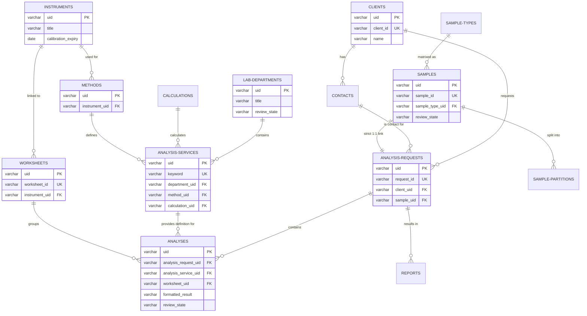

<!-- # senaite-mysql-populator
Batch script to populate a MySQL database from SENAITE data for Metabase reporting. -->

# SENAITE MySQL Populator & Metabase Report

This project provides an automated data pipeline (Python batch script) to synchronize laboratory data from **SENAITE LIMS** into a relational **MySQL database**. This layout enables advanced analytics, business intelligence, and dashboarding within **Metabase**.

---

## 📊 Data Model (ERD)

This data model maps the core entities of SENAITE, split into configuration, CRM, operational laboratory workflows, reporting, and auditing.

## 🛠️ Database Setup

To initialize the database environment, the raw SQL definitions are available in `/database/schema.sql`.

---

## 🔄 Python Batch Program (Cron)

The synchronization script runs as a periodic batch job using `cron`. It fetches modified objects from the **SENAITE JSON API** and writes them transactionally to MySQL.
